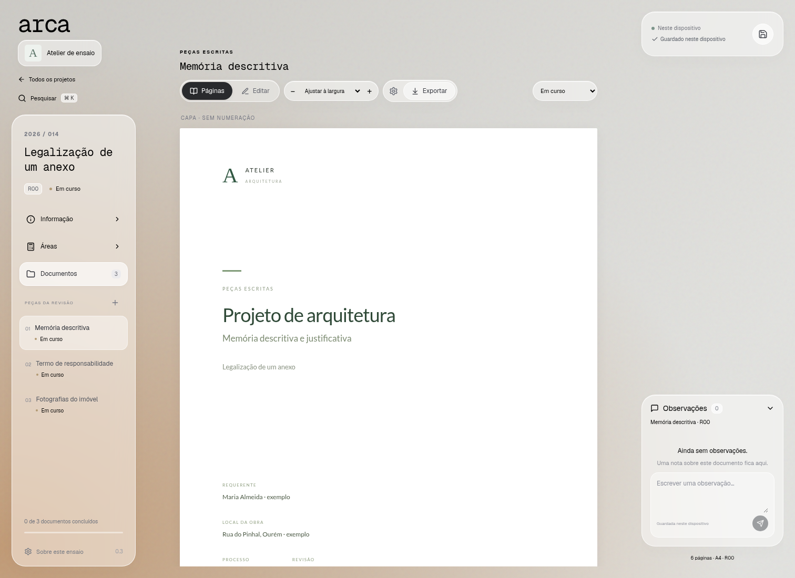

# arca — demonstração de peças escritas

Demonstração com dados e imagens fictícios. O projeto de desenvolvimento e os anexos originais continuam privados.

## Como ficou

[Ver o editor](site/vista-do-editor.png) · [Descarregar a demonstração ZIP](https://github.com/edgarerr/atelier-demo/raw/refs/heads/main/site/Atelier-demonstracao.zip)

## Abrir como aplicação

**[Abrir a demonstração](https://edgarerr.github.io/atelier-demo/)**

Publicação confirmada pelo GitHub Pages em 7 de outubro de 2026: workflow [37664542099](https://github.com/edgarerr/atelier-demo/actions/runs/37664542099), estado Success. O proprietário ativou GitHub Actions em Settings → Pages. O repositório de desenvolvimento e os anexos originais mantêm-se privados.

## O que pode experimentar

- Início do projeto e criação com operações combináveis; o quadro mostra as situações correspondentes em conjunto.
- Áreas extensíveis, decomposição e novas fórmulas de soma/subtração com valores ligados.
- Navegação por ícones, pesquisa por ⌘/Ctrl K, zoom compacto, estados e observações.
- Imagem ou cor por projeto, sem seletor de fundo geral para o utilizador.
- Campos automáticos identificados ao clicar, caixas de texto e fontes próprias TTF/OTF.
- Texto, tabelas, hifenização experimental e layouts mestres de texto normal, acessíveis na barra superior.
- Documentos de texto e PDFs importados: campos de formulário ou textos sobrepostos com ligações aos dados; exportação do PDF preenchido.
- Word e impressão para PDF nos documentos de texto.

## Limites desta versão

Usar apenas dados fictícios. Os dados são guardados neste navegador, sem contas, sincronização ou revisões protegidas. A cópia publicada é uma demonstração HTML autónoma: abrir o endereço online exige ligação; não foi instalada a cache offline completa da futura aplicação.

A edição é contínua, com visualização paginada separada. A edição diretamente nas páginas, a fidelidade do Word em Windows/macOS e PDF/A continuam por validar. Não utilizar para entregas. PDFs importados precisam de ensaio com os formulários reais das entidades; XFA, assinaturas digitais e conformidade PDF/A não são suportados nesta prova. Fontes importadas não são incorporadas no Word: devem estar instaladas no computador. Caixas de texto acompanham o fluxo do documento; não são objetos flutuantes.

Esta distribuição contém apenas a aplicação compilada, imagens fictícias, instruções e licenças. Não inclui histórico ou documentos do repositório privado. Consultar `site/LICENCAS.txt`. Nenhum serviço pago foi contratado.

Atualização arca de 14 de outubro de 2026 publicada com sucesso: [execução 38586795850](https://github.com/edgarerr/atelier-demo/actions/runs/38586795850), commit `1ac4108`.
